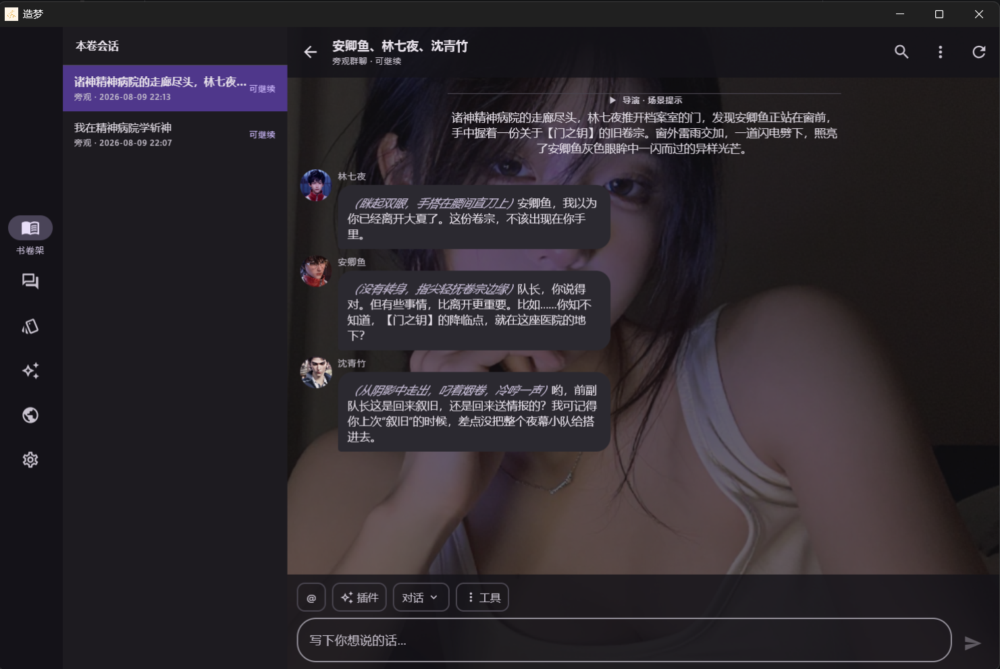
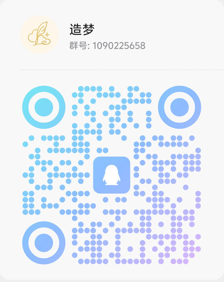

<p align="center">
  
</p>

# 造梦

> “有些角色不是被写完了，只是还没被真正叫醒。”

把中文小说人物蒸馏成可复用的人物包，抽取关系图谱，再让角色按自己的性格、立场、关系和记忆重新开口说话。

[](LICENSE) · [官网](https://dz3197578117-lab.github.io/zaomeng/) · [English](README.en.md)

> 本仓库是在上游造梦 2.0 基础上继续改的版本（当前 **2.1.2**），改动见下方「本版改动」。

## 本版改动

相比上游 2.0，本版主要补了两件事：**不联网也能跑**、**国内模型开箱可用**。

| 改动 | 说明 |
| --- | --- |
| 新增 · 端侧本机推理 | APK 内嵌 llama.cpp 运行时，设置内新增「本机模型」页，可导入 GGUF。章节摘要 / 对话单轮续写 / 关系与时间线抽取 / 蒸馏主线均可走本机，不填 API Key 也能用，模型与推理数据不出设备 |
| 提供方预设 +5 家 | 新增商汤 SenseNova、硅基流动、月之暗面 Kimi、智谱 GLM、MiniMax（预设合计 16 家） |
| 按接口动态拉取模型清单 | 模型配置页可「从接口拉取模型」，走 `GET {baseUrl}/models` 填充下拉；失败自动回退内置预设 |
| 修好 Ollama 地址 | `http://127.0.0.1:11434` → 补上 `/v1`，否则会拼出错误的 `/chat/completions` |
| 修掉端侧推理 500 | 归一化对话消息形状（最多一条 system 且必须在首位），修开放权重模型 GGUF 内置 Jinja 模板报 `System message must be at the beginning.` 的问题 |

## 项目构成

| 目录 | 说明 | 维护状态 |
| --- | --- | --- |
| [`kmp/`](kmp/README.md) | Compose Multiplatform 客户端：Android / 桌面 / iOS 三端共享 UI，内嵌 Ktor + Room 后端 | ✅ 当前主力 |
| `zaomeng-skill/` | OpenClaw / ClawHub skill 包（命令行 / 代理环境使用） | ✅ 保留 |
| `src/`、`src/web/` | 早期 Python 后端与 Web UI | ⛔ **不再维护**，仅作行为对照与测试基线 |

## 安装

### 客户端

预编译的 Android 包见 [Releases](https://github.com/dz3197578117-lab/zaomeng/releases/latest)（`arm64-v8a`，当前为 2.1.2 调试版，随包内嵌 llama.cpp 运行时）。桌面 / iOS 的构建说明见 [`kmp/README.md`](kmp/README.md)。

> ⚠️ 从旧版 Android（1.5.0 及更早）升级到 **2.0.0** 为**阻断性升级**，本地数据不兼容、不会自动迁移；升级前请先在旧版导出书卷包（`.zaomeng-run.zip`）备份。

### skill 包

```bash
# 本地 skills 目录（本仓库自带 zaomeng-skill/）
python scripts/install_skill.py --skills-dir <你的-skills-根目录>

# 或装进某个项目：会落到 <项目根>/skills/zaomeng-skill
python scripts/install_skill.py --project-root <项目根>

# ClawHub（按名称从注册表安装）
npx clawhub@latest install zaomeng-skill
```

### Web UI（旧版，不再维护，仍可安装使用）

```bash
# 一键安装（Linux / macOS / WSL2 / Termux）
curl -fsSL https://raw.githubusercontent.com/dz3197578117-lab/zaomeng/main/scripts/install.sh | bash
source ~/.bashrc
zaomeng
```

安装后常用命令：`zaomeng web --reload`（启动 Web UI，访问 `http://127.0.0.1:8000`）、`zaomeng uninstall`、`zaomeng update`。手动方式：`pip install -r requirements.runtime.txt` 后运行 `python scripts/run_webui.py --reload`。依赖：完整开发/测试用 `requirements.txt`，Termux 用 `requirements.termux.txt`（含 `httpx2` 等 Web 测试依赖；EPUB 解析为可选能力）。

## 截图

| 手机端 | 桌面端 |
| --- | --- |
|  |  |

## 社区

- QQ 交流群：**1090225658**

<p>
  
</p>

- 书卷包投稿 / 问题反馈：[Issues](https://github.com/dz3197578117-lab/zaomeng/issues)

## 赞助支持

如果造梦对你有所帮助，欢迎请作者喝杯奶茶 🧋

每一笔支持都会用于持续开发新功能、修复 Bug、提升项目稳定性，以及购买模型 API Token 用于功能测试与体验优化。感谢你帮助造梦走得更远。

<table>
  <tr>
    <td align="center">
      
    </td>
    <td align="center">
      
    </td>
  </tr>
</table>

## 许可证

[AGPL-3.0](LICENSE)
